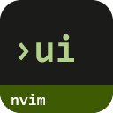
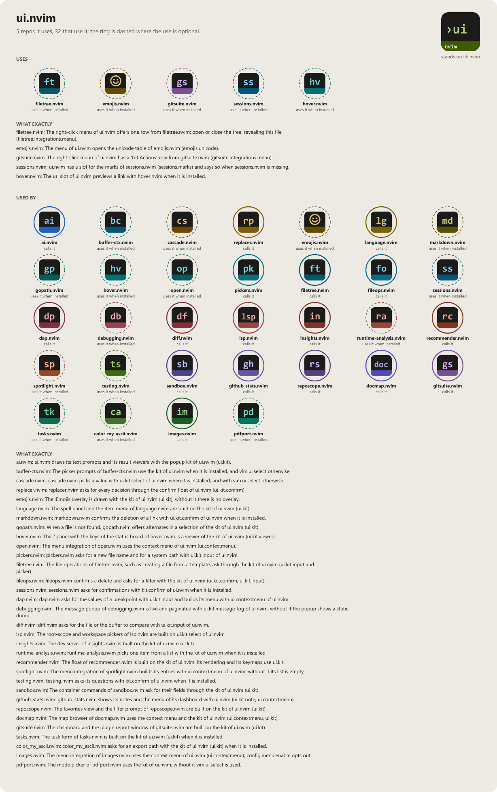

> **Alpha.** All statusline, tabline and theme code stands on Neovim's own APIs —
> neither NvChad nor base46 are required any more, including by the reference host
> this plugin was extracted from. See [the migration record](docs/nvchad-migration.md)
> for how it got there, and pin a commit if you depend on it.

# ui.nvim

```
██╗   ██╗██╗
██║   ██║██║
██║   ██║██║
██║   ██║██║
╚██████╔╝██║
 ╚═════╝ ╚═╝
       .nvim
```

[](LICENSE)
[](https://neovim.io)
[](https://www.lua.org)

[](https://wkdsteve.github.io/wkd/p/ui/)

> Part of the [wkd](https://wkdsteve.github.io/wkd/) family — see this plugin's [page](https://wkdsteve.github.io/wkd/p/ui/) on the site.

The frame around the window: statusline, tabline, theme assembly — standing on
Neovim's own APIs rather than a distribution's. Started from roughly 4,500
lines of working statusline, tabline and theme code extracted out of a NvChad-based
config, and replaced the coupling to NvChad and base46 symbol by symbol from there.

---

## Contents

- [Around it](#around-it)
- [Installation](#installation)
- [Documentation](#documentation)
- [License](#license)

---

## Around it

> **[casedesk.nvim](https://github.com/WKDSteve/casedesk.nvim)**,
> **[filetree.nvim](https://github.com/WKDSteve/filetree.nvim)**,
> **[github_stats.nvim](https://github.com/WKDSteve/github_stats.nvim)**,
> **[runtime-analysis.nvim](https://github.com/WKDSteve/runtime-analysis.nvim)**,
> **[recommender.nvim](https://github.com/WKDSteve/recommender.nvim)**,
> **[sessions.nvim](https://github.com/WKDSteve/sessions.nvim)** and
> **[sandbox.nvim](https://github.com/WKDSteve/sandbox.nvim)** — each
> contributes one optional statusline segment (a case-info badge, a cwd-mode
> badge, a weekly-views badge, a health ampel, an alias-suggestion count, the
> active session name, an ambient container summary); none is a dependency,
> and the segment is simply absent without it. The full list, with the exact
> wiring snippet for each, is [docs/modules.md](docs/modules.md).
>
> **[my.nvim](https://github.com/WKDSteve/my.nvim)** — the winbar's actual content owner. `ui.winbar.set()` is the
> frame's scheduled, window-validity-checked write; my.nvim's breadcrumbs
> module keeps the debouncing, skip-rules and the string itself, and hands
> the result over.
>
> All of the above are soft: without them everything else works unchanged.
> [lib.nvim](https://github.com/WKDSteve/lib.nvim) is the one real
> dependency (commit `863952e` or newer recommended) — see
> [Requirements](docs/requirements.md).
>
> The traffic also runs the other way, at far greater scale: `ui.kit` (float
> pickers, input, confirm, menu, toast, viewer, ...) and `ui.contextmenu` are
> the shared UI toolkit roughly twenty sibling plugins build their prompts,
> confirmations and right-click menus on top of — every one of them through a
> `pcall`, so ui.nvim stays a soft dependency on their side too. `ui.kit` and
> `ui.contextmenu` are documented in [modules.md](docs/modules.md)'s
> "Building your own module" pointers and in their own module headers under
> [`lua/ui/kit/`](lua/ui/kit/) and
> [`lua/ui/contextmenu/`](lua/ui/contextmenu/).

---

## Installation

[lazy.nvim](https://github.com/folke/lazy.nvim):

```lua
{
  "WKDSteve/ui.nvim",
  lazy = false,
  dependencies = { "WKDSteve/lib.nvim" },
  config = function()
    require("ui").setup({ all = true })
  end,
},
```

`lazy = false` rather than an event: this plugin owns `vim.o.statusline` and
`vim.o.tabline`, so deferring it leaves the previous owner's frame on screen
until the trigger fires.

`setup()` takes no required options — `{ all = true }` turns on the keymaps
and the `:UI` command, `setup()` with no argument leaves both off and enables
nothing but the context menu. See
[Configuration](docs/configuration.md) for the rest, and
[Requirements](docs/requirements.md) for the one dependency and the optional
integrations.

With [packer.nvim](https://github.com/wbthomason/packer.nvim):

```lua
use({
  "WKDSteve/ui.nvim",
  requires = { "WKDSteve/lib.nvim" },
  config = function()
    require("ui").setup({ all = true })
  end,
})
```

Or with Neovim 0.12's built-in `vim.pack`:

```lua
vim.pack.add({
  { src = "https://github.com/WKDSteve/lib.nvim" },
  { src = "https://github.com/WKDSteve/ui.nvim" },
})
require("ui").setup({ all = true })
```

Then run `:checkhealth ui`.

---

## Documentation

Start at [docs/README.md](docs/README.md), which says what is where.

**The Basics**

- [Requirements](docs/requirements.md) — Neovim version, required plugins, and the optional soft integrations.
- [What it does and what not](docs/scope.md) — statusline, tabline, theme and winbar; what stays out on purpose.

**Configuration**

- [Configuration](docs/configuration.md) — both setup entry points and the four statusline presets.
- [Statusline modules](docs/modules.md) — every segment this plugin ships, one line each, with a copy-pasteable wiring snippet.
- [Bindings cheatsheet](docs/BINDINGS.md) — commands, keymaps and autocommands.

**The Rest**

- [vim.ui through the kit](lua/ui/vim_ui/README.md) — `vim.ui.select` / `vim.ui.input` as buttons, chooser or your picker; opt-in.
- [Slots](lua/ui/slots/README.md) — numbered slots that open files and addresses, copy text, run commands; chips or panel, with previews.
- [Health check](docs/health.md) — what `:checkhealth ui` reports, line by line.
- [Credits & the NvChad migration record](docs/nvchad-migration.md) — where this started, and the step-by-step decision record of how the NvChad/base46 coupling was replaced.
- [Feedback](https://github.com/WKDSteve/ui.nvim/issues)

`:help ui` is the same reference inside the editor.

---

## License

[](LICENSE)

ui.nvim is released under the [MIT License](https://opensource.org/licenses/MIT).

<!-- connections:begin (written by the app-icons tool of the workshop; change integrations.json there, not this block) -->
## Connections



**Uses**

- [emojis.nvim](https://github.com/WKDSteve/emojis.nvim): The menu of ui.nvim opens the unicode table of emojis.nvim (`emojis.unicode`). ([picture](assets/graphs/pair/ui.nvim--emojis.nvim.png))
- [filetree.nvim](https://github.com/WKDSteve/filetree.nvim): The right-click menu of ui.nvim offers one row from filetree.nvim: open or close the tree, revealing this file (`filetree.integrations.menu`). ([picture](assets/graphs/pair/ui.nvim--filetree.nvim.png))
- [gitsuite.nvim](https://github.com/WKDSteve/gitsuite.nvim): The right-click menu of ui.nvim has a 'Git Actions' row from gitsuite.nvim (`gitsuite.integrations.menu`). ([picture](assets/graphs/pair/ui.nvim--gitsuite.nvim.png))
- [hover.nvim](https://github.com/WKDSteve/hover.nvim): The url slot of ui.nvim previews a link with hover.nvim when it is installed. ([picture](assets/graphs/pair/ui.nvim--hover.nvim.png))
- [sessions.nvim](https://github.com/WKDSteve/sessions.nvim): ui.nvim has a slot for the marks of sessions.nvim (`sessions.marks`) and says so when sessions.nvim is missing. ([picture](assets/graphs/pair/ui.nvim--sessions.nvim.png))
- [lib.nvim](https://github.com/WKDSteve/lib.nvim): the shared base of the plugins.

**Used by**

- [ai.nvim](https://github.com/WKDSteve/ai.nvim): ai.nvim draws its text prompts and its result viewers with the popup kit of ui.nvim (`ui.kit`). ([picture](assets/graphs/pair/ai.nvim--ui.nvim.png))
- [buffer-ctx.nvim](https://github.com/WKDSteve/buffer-ctx.nvim): The picker prompts of buffer-ctx.nvim use the kit of ui.nvim when it is installed, and `vim.ui.select` otherwise. ([picture](assets/graphs/pair/buffer-ctx.nvim--ui.nvim.png))
- [cascade.nvim](https://github.com/WKDSteve/cascade.nvim): cascade.nvim picks a value with `ui.kit.select` of ui.nvim when it is installed, and with `vim.ui.select` otherwise. ([picture](assets/graphs/pair/cascade.nvim--ui.nvim.png))
- [color_my_ascii.nvim](https://github.com/WKDSteve/color_my_ascii.nvim): color_my_ascii.nvim asks for an export path with the kit of ui.nvim (`ui.kit`) when it is installed. ([picture](assets/graphs/pair/color_my_ascii.nvim--ui.nvim.png))
- [dap.nvim](https://github.com/WKDSteve/dap.nvim): dap.nvim asks for the values of a breakpoint with `ui.kit.input` and builds its menu with `ui.contextmenu` of ui.nvim. ([picture](assets/graphs/pair/dap.nvim--ui.nvim.png))
- [debugging.nvim](https://github.com/WKDSteve/debugging.nvim): The message popup of debugging.nvim is live and paginated with `ui.kit.message_log` of ui.nvim; without it the popup shows a static dump. ([picture](assets/graphs/pair/debugging.nvim--ui.nvim.png))
- [diff.nvim](https://github.com/WKDSteve/diff.nvim): diff.nvim asks for the file or the buffer to compare with `ui.kit.input` of ui.nvim. ([picture](assets/graphs/pair/diff.nvim--ui.nvim.png))
- [docmap.nvim](https://github.com/WKDSteve/docmap.nvim): The map browser of docmap.nvim uses the context menu and the kit of ui.nvim (`ui.contextmenu`, `ui.kit`). ([picture](assets/graphs/pair/docmap.nvim--ui.nvim.png))
- [emojis.nvim](https://github.com/WKDSteve/emojis.nvim): The `:Emojis` overlay is drawn with the kit of ui.nvim (`ui.kit`); without it there is no overlay. ([picture](assets/graphs/pair/emojis.nvim--ui.nvim.png))
- [fileops.nvim](https://github.com/WKDSteve/fileops.nvim): fileops.nvim confirms a delete and asks for a filter with the kit of ui.nvim (`ui.kit.confirm`, `ui.kit.input`). ([picture](assets/graphs/pair/fileops.nvim--ui.nvim.png))
- [filetree.nvim](https://github.com/WKDSteve/filetree.nvim): The file operations of filetree.nvim, such as creating a file from a template, ask through the kit of ui.nvim (`ui.kit` input and picker). ([picture](assets/graphs/pair/filetree.nvim--ui.nvim.png))
- [github_stats.nvim](https://github.com/WKDSteve/github_stats.nvim): github_stats.nvim shows its notes and the menu of its dashboard with ui.nvim (`ui.kit.note`, `ui.contextmenu`). ([picture](assets/graphs/pair/github_stats.nvim--ui.nvim.png))
- [gitsuite.nvim](https://github.com/WKDSteve/gitsuite.nvim): The dashboard and the plugin report window of gitsuite.nvim are built on the kit of ui.nvim (`ui.kit`). ([picture](assets/graphs/pair/gitsuite.nvim--ui.nvim.png))
- [gopath.nvim](https://github.com/WKDSteve/gopath.nvim): When a file is not found, gopath.nvim offers alternates in a selection of the kit of ui.nvim (`ui.kit`). ([picture](assets/graphs/pair/gopath.nvim--ui.nvim.png))
- [hover.nvim](https://github.com/WKDSteve/hover.nvim): The `?` panel with the keys of the status board of hover.nvim is a viewer of the kit of ui.nvim (`ui.kit.viewer`). ([picture](assets/graphs/pair/hover.nvim--ui.nvim.png))
- [images.nvim](https://github.com/WKDSteve/images.nvim): The menu integration of images.nvim uses the context menu of ui.nvim (`ui.contextmenu`); `config.menu.enable` opts out. ([picture](assets/graphs/pair/images.nvim--ui.nvim.png))
- [insights.nvim](https://github.com/WKDSteve/insights.nvim): The dev server of insights.nvim is built on the kit of ui.nvim (`ui.kit`). ([picture](assets/graphs/pair/insights.nvim--ui.nvim.png))
- [language.nvim](https://github.com/WKDSteve/language.nvim): The spell panel and the item menu of language.nvim are built on the kit of ui.nvim (`ui.kit`). ([picture](assets/graphs/pair/language.nvim--ui.nvim.png))
- [lsp.nvim](https://github.com/WKDSteve/lsp.nvim): The root-scope and workspace pickers of lsp.nvim are built on `ui.kit.select` of ui.nvim. ([picture](assets/graphs/pair/lsp.nvim--ui.nvim.png))
- [markdown.nvim](https://github.com/WKDSteve/markdown.nvim): markdown.nvim confirms the deletion of a link with `ui.kit.confirm` of ui.nvim when it is installed. ([picture](assets/graphs/pair/markdown.nvim--ui.nvim.png))
- [open.nvim](https://github.com/WKDSteve/open.nvim): The menu integration of open.nvim uses the context menu of ui.nvim (`ui.contextmenu`). ([picture](assets/graphs/pair/open.nvim--ui.nvim.png))
- [pdfport.nvim](https://github.com/WKDSteve/pdfport.nvim): The mode picker of pdfport.nvim uses the kit of ui.nvim; without it `vim.ui.select` is used. ([picture](assets/graphs/pair/pdfport.nvim--ui.nvim.png))
- [pickers.nvim](https://github.com/WKDSteve/pickers.nvim): pickers.nvim asks for a new file name and for a system path with `ui.kit.input` of ui.nvim. ([picture](assets/graphs/pair/pickers.nvim--ui.nvim.png))
- [recommender.nvim](https://github.com/WKDSteve/recommender.nvim): The float of recommender.nvim is built on the kit of ui.nvim: its rendering and its keymaps use `ui.kit`. ([picture](assets/graphs/pair/recommender.nvim--ui.nvim.png))
- [replacer.nvim](https://github.com/WKDSteve/replacer.nvim): replacer.nvim asks for every decision through the confirm float of ui.nvim (`ui.kit.confirm`). ([picture](assets/graphs/pair/replacer.nvim--ui.nvim.png))
- [reposcope.nvim](https://github.com/WKDSteve/reposcope.nvim): The favorites view and the filter prompt of reposcope.nvim are built on the kit of ui.nvim (`ui.kit`). ([picture](assets/graphs/pair/reposcope.nvim--ui.nvim.png))
- [runtime-analysis.nvim](https://github.com/WKDSteve/runtime-analysis.nvim): runtime-analysis.nvim picks one item from a list with the kit of ui.nvim when it is installed. ([picture](assets/graphs/pair/runtime-analysis.nvim--ui.nvim.png))
- [sandbox.nvim](https://github.com/WKDSteve/sandbox.nvim): The container commands of sandbox.nvim ask for their fields through the kit of ui.nvim (`ui.kit`). ([picture](assets/graphs/pair/sandbox.nvim--ui.nvim.png))
- [sessions.nvim](https://github.com/WKDSteve/sessions.nvim): sessions.nvim asks for confirmations with `kit.confirm` of ui.nvim when it is installed. ([picture](assets/graphs/pair/sessions.nvim--ui.nvim.png))
- [spotlight.nvim](https://github.com/WKDSteve/spotlight.nvim): The menu integration of spotlight.nvim builds its entries with `ui.contextmenu` of ui.nvim; without it its list is empty. ([picture](assets/graphs/pair/spotlight.nvim--ui.nvim.png))
- [tasks.nvim](https://github.com/WKDSteve/tasks.nvim): The task form of tasks.nvim is built on the kit of ui.nvim (`ui.kit`) when it is installed. ([picture](assets/graphs/pair/tasks.nvim--ui.nvim.png))
- [testing.nvim](https://github.com/WKDSteve/testing.nvim): testing.nvim asks its questions with `kit.confirm` of ui.nvim when it is installed. ([picture](assets/graphs/pair/testing.nvim--ui.nvim.png))
<!-- connections:end -->
